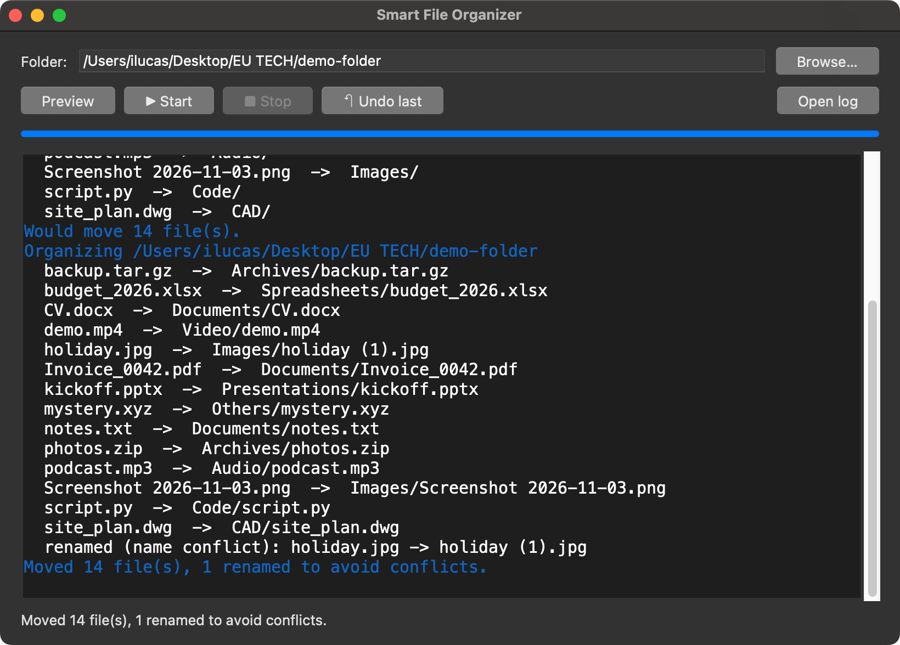
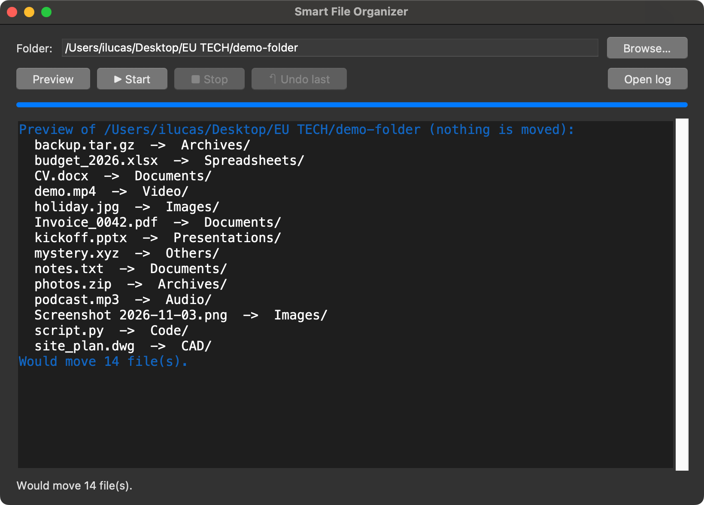
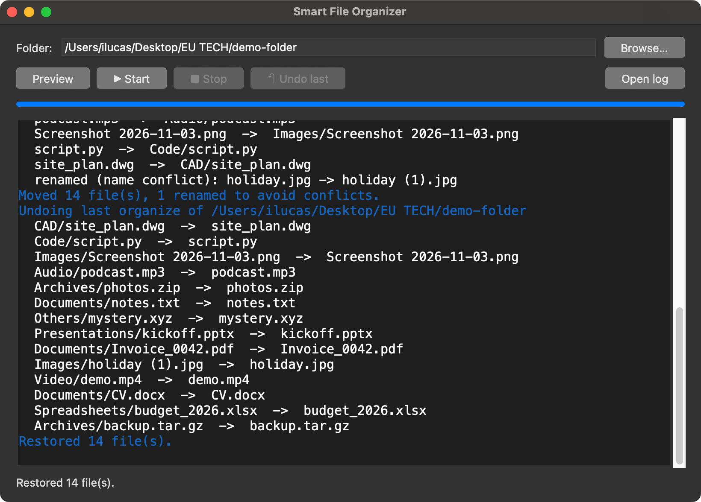
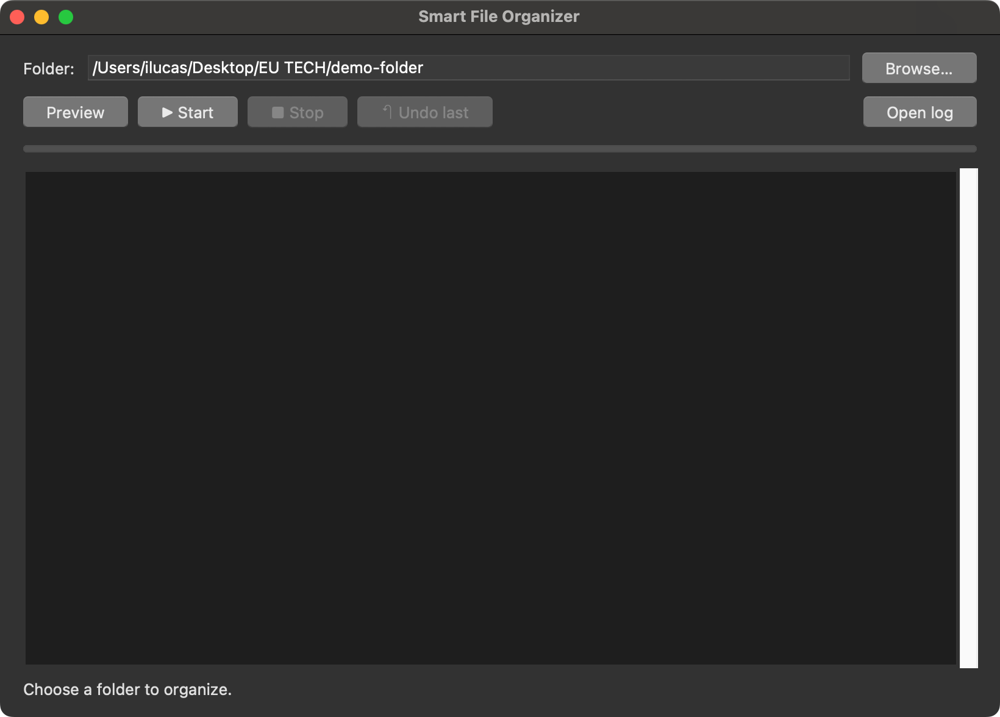

# Smart File Organizer

Automatically sorts the files of a folder into subfolders (`Images/`, `Documents/`,
`CAD/`, …) based on their extension or on custom name rules. Every move is logged
and can be undone. It runs as a desktop app (tkinter) or as a text menu.

Written in object-oriented Python using only the standard library.



## Features

| Requirement | How it is done |
|---|---|
| Scan files in a folder | `FileScanner` lists the files at the top level of a folder. It skips subfolders, hidden files (`.DS_Store`) and symlinks. |
| Classify by extension | `Classifier` maps extensions to 11 categories (case-insensitive, understands `.tar.gz`). Unknown types go to `Others/`. |
| Custom rules | Optional JSON config with wildcard rules such as `invoice*` → `Invoices/`. Rules are checked before extensions. |
| Move files | `FileOrganizer` creates the category folders and moves files with `shutil.move()`. |
| Logging | Every move is written to `organizer.log` with time, source and destination. |
| Menu | Text menu (`--cli`) to choose a folder, preview, organize, undo and view history. |
| Undo | Each run is saved as a session in `history.json`. **Undo last** moves the files back and removes the folders it created. The history survives restarting the app. |
| GUI | tkinter window with folder picker, Preview, **Start** / **Stop**, Undo, progress bar and live log. |
| Error handling | Name conflicts are resolved automatically (`photo (1).jpg`). Permission errors, missing files and blocked folders are reported per file, and the rest of the run continues. |
| Tests | 28 unit tests (`unittest`) cover every feature above. |

## Requirements

- Python **3.9 or newer**
- tkinter for the GUI. It ships with the python.org installers for Windows and macOS.
  On Homebrew Python run `brew install python-tk@3.14` (match your Python version).
  On Debian/Ubuntu run `sudo apt install python3-tk`.
  Without tkinter the program falls back to the text menu.

No third-party packages are needed.

## Getting started

```bash
git clone https://github.com/lucasjeglic/Smart-File-Organizer.git
cd Smart-File-Organizer
```

### GUI

```bash
python3 -m smart_organizer                  # then click "Browse…"
python3 -m smart_organizer ~/Downloads      # folder pre-filled
```

1. **Browse…** to choose a folder, or type its path.
2. **Preview** shows where each file would go, without moving anything.
3. **▶ Start** asks for confirmation, then moves the files. **■ Stop** halts the run after the current file. Files moved so far stay recorded, so they can still be undone.
4. **↶ Undo last** moves every file of the last run back to where it was.
5. **Open log** shows the log file.

### Text menu

```bash
python3 -m smart_organizer --cli
```

```
=== Smart File Organizer ===

Current folder: ~/Downloads
  1. Choose folder to organize
  2. Preview (dry run, nothing is moved)
  3. Organize now
  4. Undo last organize
  5. Show history
  6. Show categories and rules
  0. Exit
Choose an option: 3
Move 14 file(s) in ~/Downloads? [y/N] y
  [1/14] backup.tar.gz  ->  Archives/backup.tar.gz
  [2/14] budget_2026.xlsx  ->  Spreadsheets/budget_2026.xlsx
  [3/14] CV.docx  ->  Documents/CV.docx
  ...
  [5/14] holiday.jpg  ->  Images/holiday (1).jpg
  ...
Moved 14 file(s), 1 renamed to avoid conflicts.
  renamed: holiday.jpg -> holiday (1).jpg
```

### Options

| Option | Meaning |
|---|---|
| `folder` | Folder to organize (optional) |
| `--cli` | Use the text menu instead of the GUI |
| `--config FILE` | JSON file with custom categories and/or rules |
| `--data-dir DIR` | Where the log and history are kept (default `~/.smart_file_organizer`, or the `SMART_ORGANIZER_HOME` environment variable) |

### Try it safely on sample files

```bash
python3 tools/make_demo_folder.py           # creates ./demo-folder with 14 sample files
python3 -m smart_organizer demo-folder
```

The demo folder already contains `Images/holiday.jpg`, so you can see a name conflict being resolved.

## Custom rules

Create a JSON file (see [`rules.example.json`](rules.example.json)):

```json
{
  "rules": [
    {"pattern": "invoice*",    "folder": "Invoices"},
    {"pattern": "screenshot*", "folder": "Screenshots"}
  ],
  "categories": {
    "Images": [".jpg", ".png"],
    "Drawings": [".dwg", ".dxf"]
  }
}
```

- `rules` are checked first, in order. Patterns are shell wildcards (`*`, `?`, `[abc]`) matched against the file name, ignoring case.
- `categories` replaces the built-in extension table. Leave it out to keep the defaults.

```bash
python3 -m smart_organizer --config rules.example.json
```

## Log and history

Both live in `~/.smart_file_organizer/`:

- `organizer.log` is a readable log of every action:
  ```
  2026-11-12 14:57:55 | INFO    | ORGANIZE START  /Users/me/Downloads  (14 file(s))
  2026-11-12 14:57:55 | INFO    | MOVED  /Users/me/Downloads/budget_2026.xlsx  ->  /Users/me/Downloads/Spreadsheets/budget_2026.xlsx
  2026-11-12 14:57:55 | WARNING | NAME CONFLICT  /Users/me/Downloads/Images/holiday.jpg exists, using holiday (1).jpg
  2026-11-12 14:57:56 | INFO    | RESTORED  /Users/me/Downloads/CAD/site_plan.dwg  ->  /Users/me/Downloads/site_plan.dwg
  ```
- `history.json` is the "moved files" history used by undo. It lists each session's moves (source, destination, time) and the folders it created. The file is written atomically, so a crash cannot corrupt it. If it is ever unreadable, it is backed up and a fresh history is started.

## Error handling

| Situation | Behaviour |
|---|---|
| A file with the same name already exists in the destination | New file is saved as `name (1).ext`, `name (2).ext`, … Nothing is ever overwritten. |
| No permission to move a file or write a folder | That file is reported as *Permission denied* and the others continue. |
| Folder does not exist / is not readable | Reported in the GUI or menu, no crash. |
| A file occupies the name of a category folder | That file is reported and skipped. |
| On undo, the original name is taken again | File is restored as `name (1).ext`. |
| On undo, a file was deleted or moved by the user meanwhile | Skipped and reported, the rest is restored. |
| On undo, a file cannot be moved back (e.g. permissions) | It stays in the history so undo can be retried later. |
| User presses Stop | Run halts after the current file. What was moved is saved and can be undone. |

## Screenshots

| | |
|---|---|
| **Preview** shows the plan before anything is moved  | **Start** moves files and resolves a name conflict  |
| **Undo** restores every file to its original place  | **Start screen**  |

## Running the tests

```bash
python3 -m unittest -v
```

The tests work in temporary folders and never touch your real files. They cover classification, scanning, moving, logging, name conflicts, permission errors, Stop, undo (including after a restart), a corrupt history file, and the text menu.

## Project structure

```
smart_organizer/
├── __main__.py      command-line entry point (GUI or --cli)
├── rules.py         Rule, Classifier: file -> category
├── scanner.py       FileScanner: which files to organize
├── organizer.py     FileOrganizer: plan, move, undo, conflicts, errors
├── history.py       MoveRecord, Session, MoveHistory: persistent undo history
├── app_logging.py   log file setup
├── cli.py           MenuApp: text menu
└── gui.py           OrganizerGUI: tkinter window
tests/test_organizer.py
tools/make_demo_folder.py
rules.example.json
```

### Design

- **One class per responsibility.** `Classifier` decides *where* a file goes, `FileScanner` decides *which* files, `MoveHistory` remembers *what was done*, and `FileOrganizer` coordinates them. Each part can be replaced or tested on its own: the tests inject a temporary data folder, and a custom `Classifier` can be passed in.
- **Interfaces are thin.** `MenuApp` and `OrganizerGUI` only call `FileOrganizer`. All logic lives in the core, so both interfaces behave the same.
- **The GUI never freezes.** Organizing runs in a background thread. The thread does not touch widgets (tkinter is not thread-safe). It posts progress messages to a queue that the window reads every 100 ms. Stop is a `threading.Event` checked between files.
- **Only the top level is organized.** Subfolders, including category folders from earlier runs, are left untouched. Running the organizer twice is therefore safe.
